<p align="center">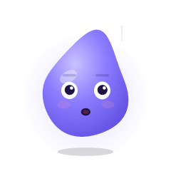</p>

<h1 align="center">Wisp</h1>

<p align="center"><b>A living character guide for any website, app or desktop app.</b><br/>
It welcomes visitors, shows them around, answers in their language, reads the page, and helps them get things done.</p>

<p align="center">
  <a href="docs/wisp-demo.mp4">▶ Watch the 1-minute video</a> ·
  <a href="docs/Wisp-Guide.pdf">📘 Read the PDF guide</a> ·
  <a href="#run-the-demo">🛍 Try the demo shop</a>
</p>

<p align="center"><a href="docs/wisp-demo.mp4">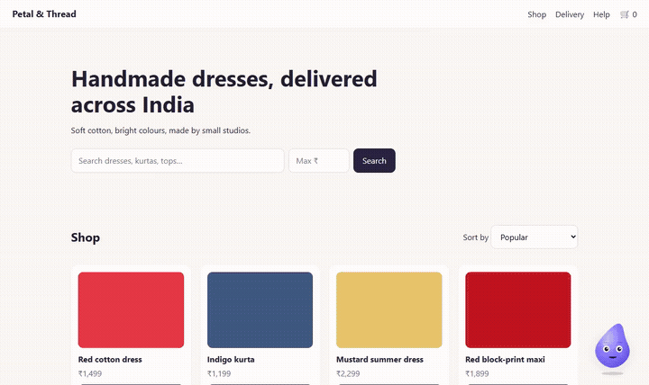</a></p>

## Meet the characters

Each product gets its own look from one short description. These five samples come built in:

<p align="center">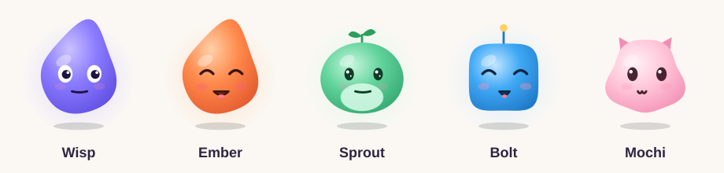</p>

Every character has 12 moods. It blinks, breathes, follows the cursor, giggles when tapped, and falls asleep when nobody is around:

<p align="center">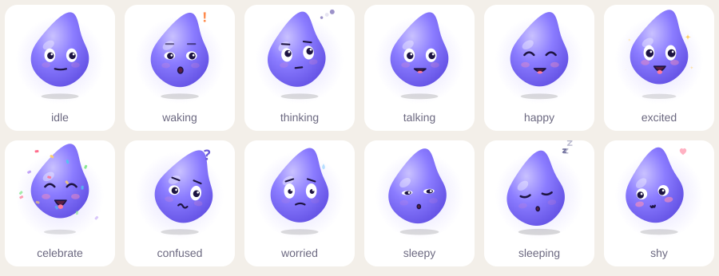</p>

<details><summary>Moods for the other samples</summary>

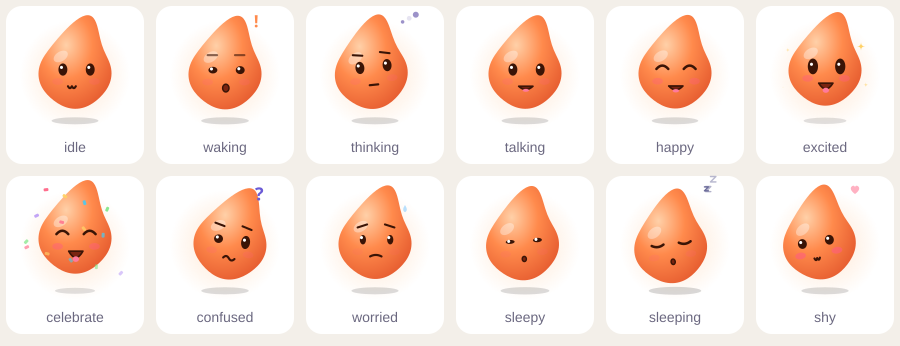
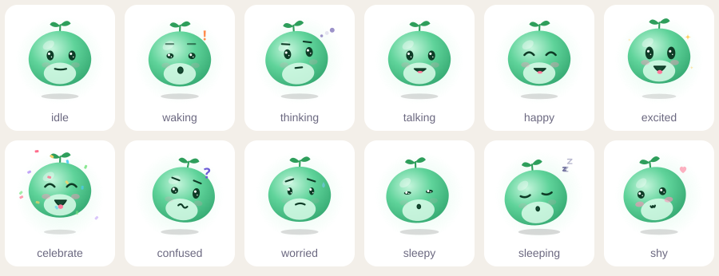
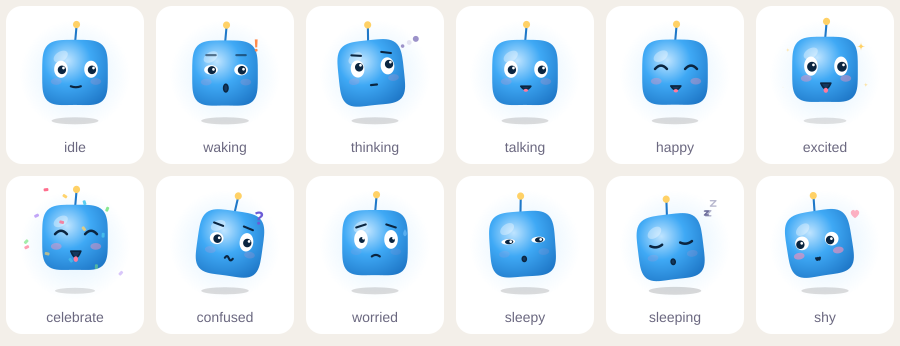
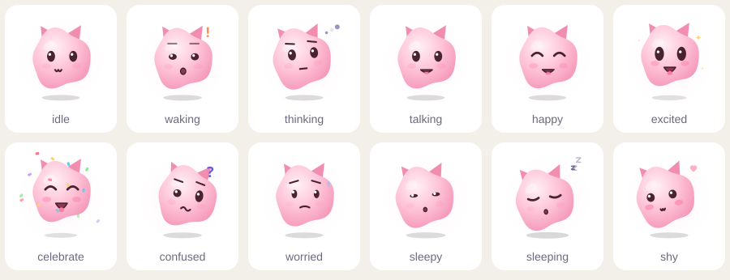
</details>

## What it does

| | |
|---|---|
| 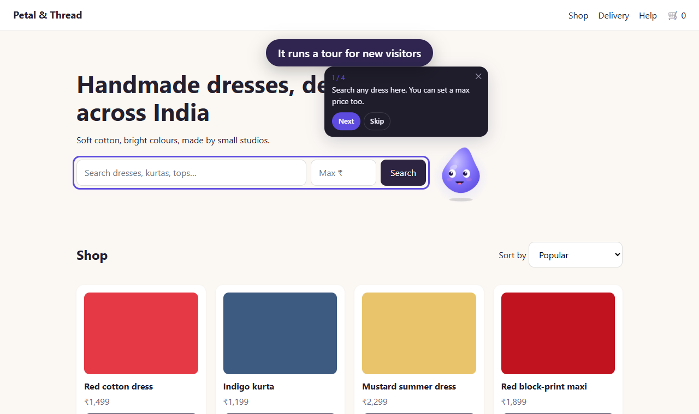<br/>**Tours** for new visitors, step by step | 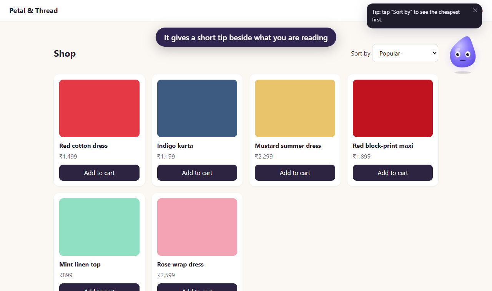<br/>**One short tip** beside the section being read |
| 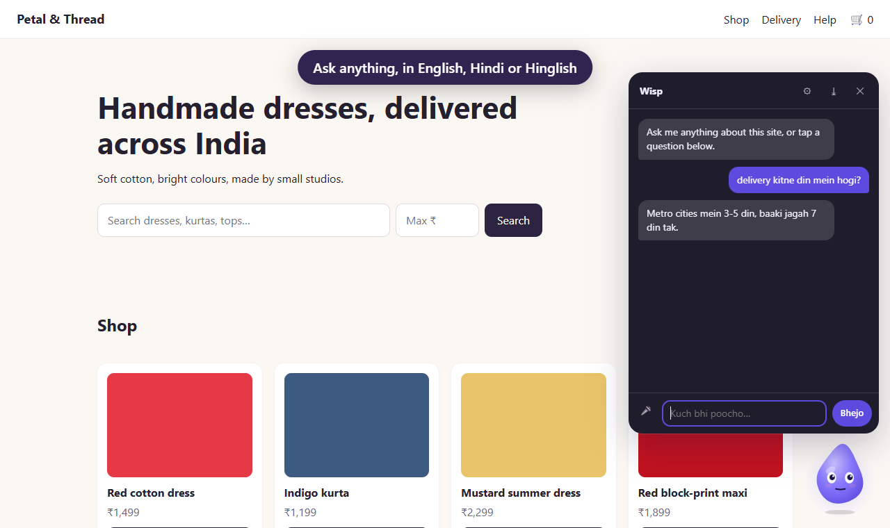<br/>**Chat** from your own FAQ and pages, in English, Hindi, Hinglish or any language you add | 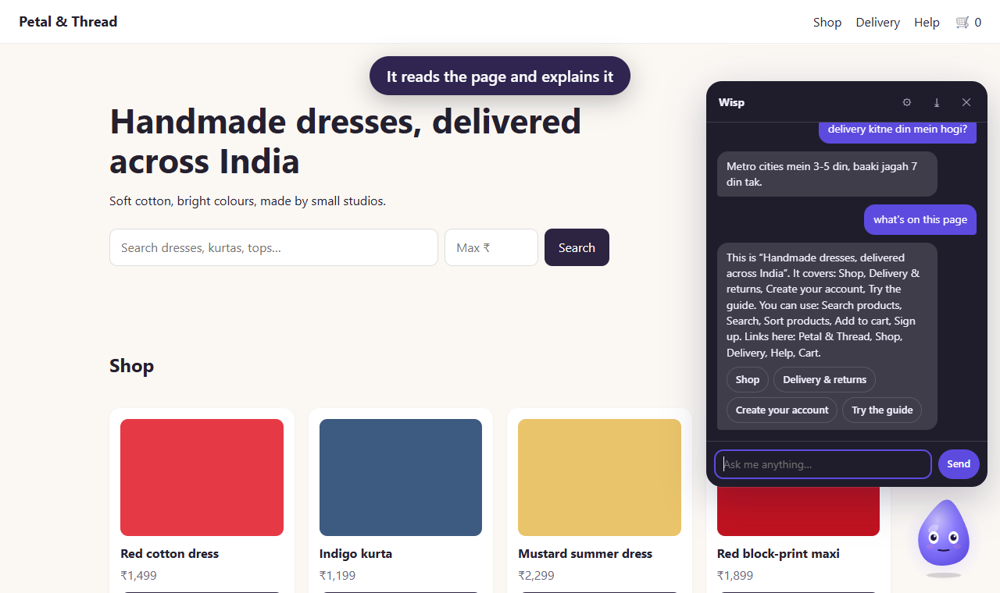<br/>**Understands the page**: explains it, finds things, points at them |
| 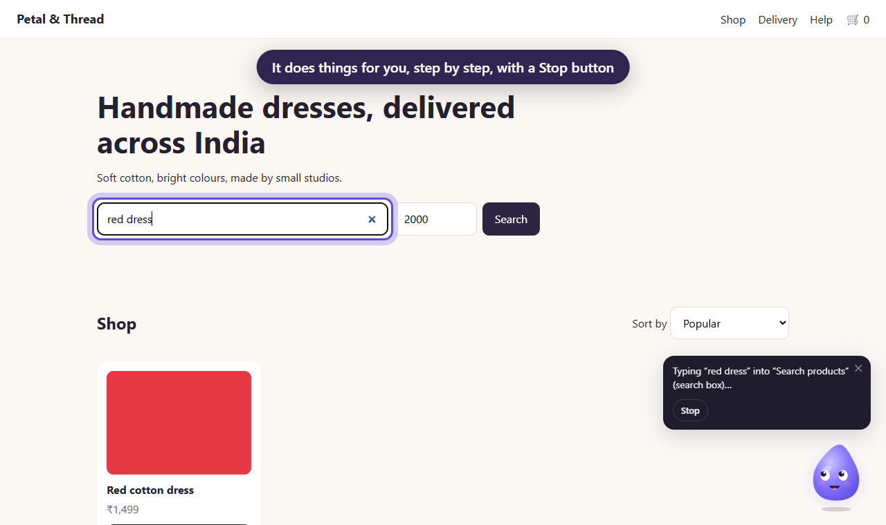<br/>**Does things** when asked, step by step, with a Stop button and a check before anything final | 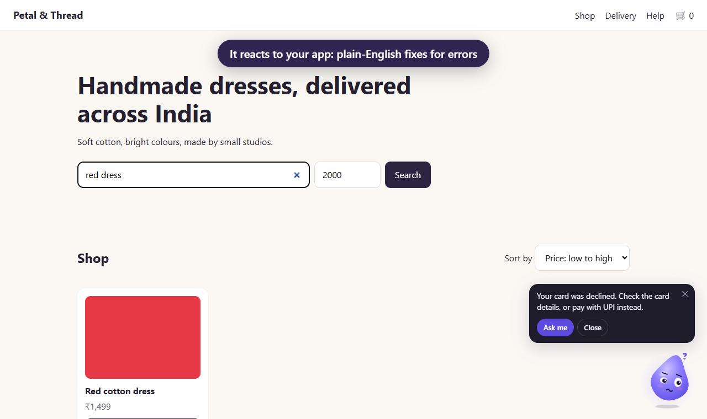<br/>**Reacts to your app**: celebrates success, explains errors in plain English |

It works fully **without AI**: moods, tours, prewritten tips, keyword FAQ chat with tap-to-answer buttons, button-driven actions and the device's own voice. Add **your own AI key** from any provider when you want it to answer in its own words.

<p align="center">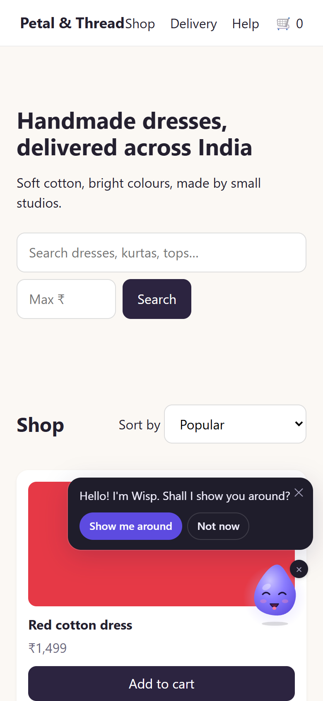<br/><sub>On phones it stays small in a corner and never sits on your buttons.</sub></p>

## Add it to any site in one line

```html
<script src="https://YOUR-CDN/wisp.js" data-config="/wisp.json" defer></script>
```

`wisp.js` is built to `packages/web/dist/wisp.js` (about 22 KB gzipped). `wisp.json` is your settings file:

```json
{
  "siteId": "my-shop",
  "character": "wisp",
  "tour": [{ "target": "#search", "text": "Search anything here." }],
  "sections": [{ "id": "pricing", "tip": "The free plan covers one project." }],
  "faq": [
    { "q": ["How long is delivery?", { "hinglish": "Delivery kitne din mein?" }],
      "a": { "en": "3 to 5 days.", "hi": "3 से 5 दिन।", "hinglish": "3 se 5 din." } }
  ],
  "errors": [{ "match": "card_declined", "fix": "Your card was declined. Try UPI instead." }]
}
```

Mark the sections it should comment on with `data-wisp-section="pricing"`, or give a `selector` in the config.

## Tell it what's happening

Fire window events from your app; Wisp never touches your forms.

```js
dispatchEvent(new CustomEvent('wisp:success', { detail: { line: 'Saved!' } }));
dispatchEvent(new CustomEvent('wisp:error', { detail: { code: 'card_declined', message: '…' } }));
dispatchEvent(new CustomEvent('wisp:loading'));   // thinking pose
dispatchEvent(new CustomEvent('wisp:loaded'));
dispatchEvent(new CustomEvent('wisp:conversion'));
dispatchEvent(new CustomEvent('wisp:cart-add'));  // any name listed under "reactions"
```

Or use the instance: `Wisp.instance.say('Hi!', 'happy')`, `.startTour()`, `.openChat()`, `.hide()`.

## React / Next.js and Vue

```tsx
import { Wisp, useWisp } from '@veloceai/wisp-react';
<Wisp config={config}><App /></Wisp>
// anywhere inside: useWisp()?.emit('success')
```

```vue
<script setup>import { Wisp } from '@veloceai/wisp-vue';</script>
<template><Wisp :config="config"><App /></Wisp></template>
```

In apps with client-side routing, pass `navigate` so FAQ links and actions switch pages without a full reload:

```tsx
const router = useRouter();
<Wisp config={config} navigate={(path) => router.push(path)}>…</Wisp>
```

Electron and Tauri apps use the web build as is.

## Its own look

Pick a sample (`wisp`, `ember`, `sprout`, `bolt`, `mochi`) or describe your own:

```json
"character": {
  "name": "Tara",
  "body": { "shape": "blob", "color": "#FF8A4C", "shade": "#E2552B", "glow": "#FFD0A8" },
  "eyes": { "style": "sparkle", "color": "#3A1406" },
  "mouth": { "style": "cat" },
  "accessory": { "kind": "antenna", "color": "#FFD166" }
}
```

Shapes: `wisp`, `round`, `squircle`, `blob`, `bean`. Eyes: `classic`, `dot`, `sparkle`. Mouths: `smile`, `cat`, `tiny`. Accessories: `antenna`, `sprout`, `ears`, `crown`.

Moods: idle, waking, thinking, talking, happy, excited, celebrate, confused, worried, sleepy, sleeping, shy. It blinks, breathes, follows the cursor, giggles when tapped, sleeps when the visitor is idle, and keeps still for people who turn on reduced motion.

## Size and style

```json
"size": "large",
"theme": { "accent": "#E2552B", "font": "Poppins, sans-serif", "radius": 8, "mode": "auto", "chatWidth": 400 }
```

- `size`: `"small"`, `"medium"` (default), `"large"`, a number of pixels (48 to 240), or per screen: `{ "desktop": "large", "phone": "small" }`. A plain number shrinks to 75% on phones.
- `theme.accent`: colour for buttons, highlights and the visitor's messages (defaults to the character's colour).
- `theme.paper`, `theme.ink`: background and text colour of the bubble and chat.
- `theme.font`, `theme.fontSize`.
- `theme.radius`: corner roundness, from 0 (square) to 28.
- `theme.mode`: `"auto"` follows the visitor's light/dark setting.
- `theme.chatWidth`, `theme.chatHeight`.

If your app has a bottom tab bar or a fixed header, tell Wisp how much room to leave: `"insets": { "bottom": 64 }`. The character, its bubble, the chat box and the "Show guide" tab all stay clear of it.

Changing these never changes behaviour. Placement, phone corners, avoiding buttons and the chat position all work from the size you set, and the chat always fits above the character. Styles live inside Wisp's own shadow DOM, so they can't affect your page and your page can't break them.

## Languages

Built-in lines are in English, Hindi and Hinglish. The visitor's language is picked up from what they type. Add any other language by writing your FAQ, tips and lines with that code (`{ "ta": "…" }`) and button labels under `"ui"`; list them in `"languages"` to show them in settings.

## It understands the page

Wisp reads the page the way a screen reader does (headings, buttons, links, form fields and text), never screenshots, and re-reads when the page changes. Visitors can ask:

- "What's on this page?" / "yeh page kya hai" → a short summary with buttons for each section
- "Where is the sort menu?" / "cart kahan hai" → it scrolls there, highlights it and hops beside it
- Any question the page text answers → answered from the page (and given to the AI as facts when AI is on)

It works without any labels. For more accuracy, add `data-wisp-label="Main search"` to name things, `data-wisp-section="pricing"` to group them, and `data-wisp-action="add-to-cart"` to tag buttons.

Privacy: passwords, card numbers, OTP, CVV, PIN and ID fields are recognised and never read. Their values are not part of what Wisp sees, and other text boxes' contents are skipped too. Mark anything else with `data-wisp-sensitive`. Hide areas completely with `data-wisp="off"`, or in config:

```json
"blocked": { "selectors": [".admin-panel"], "paths": ["/admin*", "/account/billing"] }
```

## It does things when asked

"Search red dresses under ₹2000 and sort by price" or "red dress dhundo aur price se sort karo": Wisp works it out, then clicks, types, picks and scrolls one step at a time. It says what it's doing, highlights what it touches, and shows a Stop button throughout. Simple instructions are planned without AI; with AI on, anything else is planned by the model using only the elements on the page.

Safety rules it always follows:
- It asks first before anything final: pay, buy, place order, delete, send, submit, sign up, log out, or leaving the site.
- It never types into, reads or sends passwords, card numbers, OTPs or ID numbers.
- It does nothing in blocked areas or on blocked pages.

Let it use your own functions instead of clicking around (preferred when they fit):

```json
"actions": [
  { "name": "search", "description": "Search products", "params": { "query": { "type": "string" }, "maxPrice": { "type": "number" } } },
  { "name": "track-order", "description": "Track my order", "button": "Track my order" },
  { "name": "place-order", "description": "Place the order", "final": true }
]
```

```js
Wisp.instance.registerAction('search', ({ query, maxPrice }) => runMySearch(query, maxPrice));
// or listen: addEventListener('wisp:run', (e) => e.detail.name /* e.detail.args */)
```

Actions with a `button` appear as tap-to-run buttons in chat, so they work without typing or AI. Run one from code with `Wisp.instance.run('sort by price')`. If a step opens a new page, Wisp carries on with the rest after it loads.

## Shop by voice

Like a quick-commerce assistant: tap 🎤 and keep talking until you say "done" or "bas". Wisp replies out loud and listens again.

> "give me onion" → *"I found 3. 1: Onion 1 kg, ₹39. 2: Red Onion 500 g, ₹24…"*
> "put first one in cart" → *"Added 1 × Onion. Cart total ₹39."*
> "2 kilo tamatar aur doodh daal do" · "sabse sasta chips dikhao" · "ek aur" · "remove tomato" · "total kitna hua" · "order kar do"

<p align="center">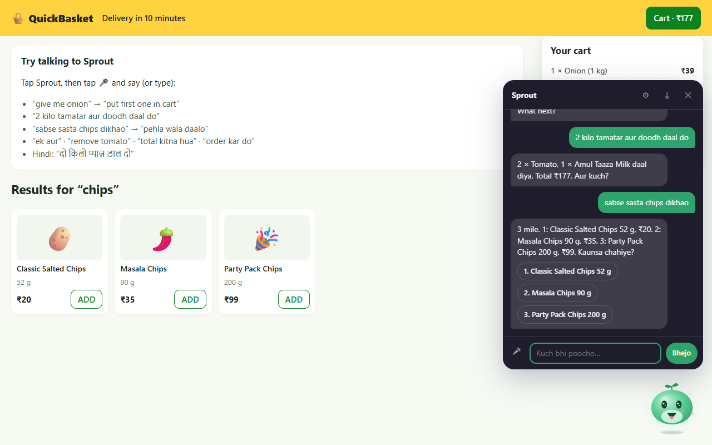</p>

It understands:
- **Find:** "give me onion", "pyaaz dikhao", "milk under 60", "sabse sasta chips".
- **Pick:** "first one", "doosra", "the cheapest", "aakhri wala".
- **Amount:** "2 kilo" becomes two 1 kg packs, or four 500 g packs if that's all there is. Also "3 packets", "ek aur", "make it 4".
- **Lists:** "onion, tomato aur 2 litre milk daal do".
- **Cart:** "remove tomato", "what's in my cart", "total kitna hua".
- **Checkout:** "order kar do" reads back the total. **It never orders on voice alone**: the visitor taps "Confirm order".

Give Wisp your store's search, cart and checkout:

```js
Wisp.instance.registerShop({
  search: async (query, { maxPrice } = {}) => [{ id, name, price, unit, inStock }],
  add: async (id, qty) => {},
  setQty: async (id, qty) => {},   // optional
  remove: async (id) => {},        // optional
  cart: async () => ({ lines: [{ id, name, qty, price }], total }),
  checkout: async () => {},        // only ever called after a tap on Confirm
});
```

```json
"shop": { "currency": "₹", "synonyms": { "pyaaz": "onion", "kanda": "onion", "doodh": "milk" } }
```

**Any language.** English, Hindi and Hinglish come built in. For any other language, add a word pack under `"shop": { "words": [...] }`; [docs/voice-word-pack-template.json](docs/voice-word-pack-template.json) shows Tamil. Listening uses the browser's own speech recognition (60+ languages, including all major Indian ones) for free. With the AI proxy and `"voice": { "mode": "ai" }`, natural AI voices are used and the language is detected automatically. Try it at `/grocery.html` in the demo.

## Bring your own AI key

Wisp works without AI. To let it answer in its own words, run the tiny proxy on your server; the key never reaches visitors' browsers.

```bash
WISP_PROVIDER=anthropic WISP_API_KEY=... WISP_ORIGINS=https://myshop.in npx wisp-proxy   # http://localhost:5181/wisp
```

Then add `"ai": { "endpoint": "https://myshop.in/wisp" }` to `wisp.json`.

Providers: `openai`, `anthropic`, `gemini`, `groq`, `openrouter`, `ollama` (local, no key), plus `mock` for testing. Set `WISP_MODEL` to pick a model; defaults are `gpt-4o-mini`, `claude-opus-5-5` (low effort), `gemini-2.5-flash`, `llama-3.3-70b-versatile`, `llama3.2`.

In Next.js or any server that speaks web `Request`/`Response`:

```ts
// app/wisp/[...route]/route.ts
import { createWispHandler } from '@veloceai/wisp-proxy';
const handler = createWispHandler({ provider: { provider: 'gemini', apiKey: process.env.GEMINI_KEY }, allowedOrigins: ['https://myshop.in'] });
export { handler as GET, handler as POST, handler as OPTIONS };
```

Express/Node: `toNodeListener(createWispHandler(...))` from `@veloceai/wisp-proxy/node`. Desktop apps (Electron/Tauri) call `createWispHandler` in the main process and keep the key in the OS keychain (Electron `safeStorage`, Tauri Stronghold).

Cost and safety built in:
- 20 AI calls per visitor per day and 60 per IP (change with `perVisitor` / `perIp`); an 8-second timeout. When the limit, the timeout or the AI fails, Wisp falls back to its prewritten answers.
- Questions matched confidently by your FAQ never call the AI.
- Card numbers, OTPs, passwords and ID numbers are removed before anything reaches the AI, in the browser and again on the server.
- Answers come only from your FAQ, docs and page; give the proxy `knowledge` to keep the facts server-side.

## Voice (off by default)

Visitors switch it on in settings. `"voice": { "mode": "browser" }` uses the device's built-in voice; `"mode": "ai"` uses the proxy's natural voice (OpenAI-compatible providers; turn it on with `WISP_VOICE=on`). Every spoken line is cached on the server, so a fixed line is paid for once. You can also ship your own recordings: `"voice": { "clips": { "welcome.first": "/audio/welcome.mp3" } }`. With voice on, a mic button lets visitors ask out loud.

## Behaviour that keeps it polite

- Sits in a corner, hops beside what you're reading on bigger screens, and on phones never sits on top of buttons (it moves, then shrinks).
- One unasked-for tip at a time, at most every 8 seconds, each tip once.
- New visitors get step-by-step help; regulars get short advanced tips. Visitors can choose "Help me a lot" or "Just tips". It always answers when tapped.
- A hide button tucks it into a small tab; it remembers that.

## Packages

| Package | What |
|---|---|
| `@veloceai/wisp-core` | The brain, moods, drawing maths, chat and memory. No UI. |
| `@veloceai/wisp-web` | The page widget and the `wisp.js` script-tag build. |
| `@veloceai/wisp-react`, `@veloceai/wisp-vue` | Thin wrappers. |
| `@veloceai/wisp-proxy` | The owner-hosted AI proxy (`wisp-proxy` CLI, web handler, Node adapter). |

## Run the demo

```bash
npm install
npm run build
npm run demo        # http://localhost:5180 — demo shop (with a mock-AI proxy at /wisp), /moods.html, /script-tag.html
```

## Develop

```bash
npm test            # 100 tests: core, web (jsdom), proxy
npm run typecheck
npm run docs:art    # redraws the character images and the animated GIF from the real drawing code
npm run docs:video  # records docs/wisp-demo.mp4 and the screenshots from the running demo (needs Chrome and ffmpeg)
npm run docs:pdf    # prints docs/guide/guide.html to docs/Wisp-Guide.pdf
```

## Roadmap

1. ✅ Core + web: character, moods, guiding, chat without AI, demo
2. ✅ Your own AI key (OpenAI, Anthropic, Gemini, Groq, OpenRouter, Ollama) through a tiny server you host, plus voice
3. ✅ Page understanding: explain the page, find and point at things
4. ✅ Actions on request, always asking before anything final
5. Expo / React Native
6. Adaptive memory and an owner report
7. Browser extension
